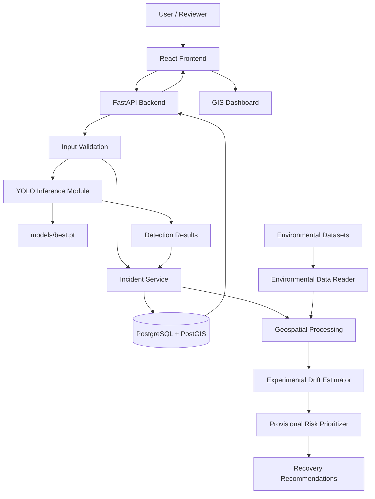
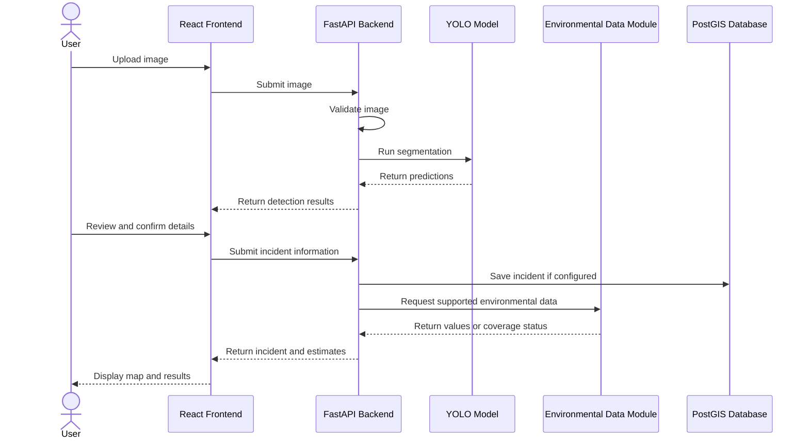

# OceanRescue — System Architecture Document (SAD)

**Official Title:** AI-Driven Geospatial Intelligence for Detection, Drift Forecasting, and Retrieval Optimization of ALDFG (Abandoned, Lost, and Discarded Fishing Gear)

**Project Name:** OceanRescue  
**Tagline:** Every Net Found. Every Life Saved.  
**Project Type:** Third-Year B.E. Computer Engineering Mini Project  
**Document Version:** 1.0  
**Status:** Architecture baseline for implementation  
**Project Root:** `ocean rescue dataset/`

---

## 1. Purpose

This System Architecture Document (SAD) defines OceanRescue's proposed system structure, technology stack, components, APIs, data flow, storage, security, testing, and implementation plan.

It is based on our established project direction, existing datasets, and trained YOLOv8 segmentation model. Features that have not yet been implemented are explicitly identified as planned or proposed.

## 2. Project Overview

OceanRescue is an AI-powered marine conservation and geospatial decision-support platform designed to help identify potential abandoned, lost, and discarded fishing gear (ALDFG).

The system combines computer vision, geospatial information, environmental datasets, drift estimation, risk prioritization, and recovery planning to help users investigate potential fishing-gear incidents.

OceanRescue is a decision-support prototype. It does not autonomously retrieve fishing gear, and its drift and risk estimates must not be treated as validated operational predictions.

### 2.1 Main Objectives

- Detect potential fishing nets and ropes in supported images.
- Display model predictions with confidence scores and segmentation masks.
- Associate reviewed detections with geographic coordinates and observation times.
- Display incidents on an interactive GIS map.
- Integrate available ocean-current, wind, wave, bathymetry, and marine-incident data.
- Experiment with drift estimation and risk-based prioritization.
- Generate candidate recovery recommendations for human review.
- Maintain transparency about model limitations, uncertainty, and data sources.

### 2.2 Target Users

- Marine conservation researchers.
- Environmental monitoring teams.
- Students and academic evaluators.
- Authorized incident reviewers.
- Recovery-planning personnel in a future deployment.

---

## 3. Minimum Viable Product (MVP)

The first working version should prioritize an end-to-end workflow instead of implementing every advanced feature immediately.

### MVP Features

1. Upload or select an image.
2. Run the existing trained YOLOv8 segmentation model.
3. Display detected `fishing_net` and `rope_line` objects.
4. Display confidence scores, bounding boxes, and segmentation masks where available.
5. Allow the user to review predictions.
6. Accept geographic coordinates and observation time from a user or trusted source.
7. Store reviewed incident information if database persistence is implemented.
8. Display incidents on an interactive map.
9. Show environmental context when suitable data are available.
10. Display experimental drift estimates and provisional risk rankings only when sufficient inputs exist.

### Out of Scope for the Initial MVP

- Autonomous fishing-gear retrieval.
- Guaranteed real-time ocean forecasting.
- Autonomous vessel navigation or dispatch.
- Claims of validated operational accuracy.
- Guaranteed live sensor or satellite feeds.
- Complex microservices infrastructure.
- Advanced deep-learning forecasting without suitable training data and evaluation.

---

## 4. Architecture Principles

The implementation must follow these principles:

- **Reuse existing assets:** Use the trained model at `models/best.pt`; do not retrain it just to begin backend integration.
- **Modular development:** Keep frontend, API, model inference, geospatial processing, and environmental-data processing separate.
- **Local-first development:** Make the application work locally before selecting deployment infrastructure.
- **Traceability:** Preserve relevant source, timestamps, coordinates, confidence scores, and model-version information.
- **Honest uncertainty:** Do not fabricate coordinates, environmental measurements, drift predictions, or incident confirmations.
- **Security:** Validate uploads, protect configuration secrets, and prevent unsafe file handling.
- **Incremental implementation:** Build and test one complete workflow before adding advanced features.
- **Human oversight:** Treat model predictions and recovery recommendations as assistance for human decisions.

---

## 5. Existing Project Assets

The following assets are known to exist in the OceanRescue project. Verify their current paths and contents before modifying or integrating them.

- `docs/PRD_OceanRescue.md`
- `docs/SRS_OceanRescue.md`
- `models/best.pt`
- `dataset_integration/`
- `fishing_gear_incidents/`
- `ocean currents dataset/`
- `wind dataset/`
- `wave dataset/`
- `bathymetry dataset/`
- `sensitive_marine_areas/`, if present
- Existing dataset reports and training notebooks

Do not move, delete, or reorganize existing datasets simply to match this document.

### 5.1 Existing Trained Model

The project already has a trained YOLOv8 segmentation checkpoint.

**Model details:**

- Model family: YOLOv8 segmentation.
- Training model: `yolov8s-seg`.
- Model path: `models/best.pt`.
- Class 0: `fishing_net`.
- Class 1: `rope_line`.
- Training was configured for 30 epochs but stopped early at epoch 19.
- Best checkpoint was recorded at epoch 11.

### 5.2 Preliminary Model Evaluation

The available validation run used 110 images containing 142 target instances. This validation subset contained no empty-label images, so it is not a representative test of false positives on background-only images.

| Metric | Preliminary result |
|---|---:|
| Bounding-box precision | 0.468 |
| Bounding-box recall | 0.370 |
| Bounding-box mAP@50 | 0.353 |
| Bounding-box mAP@50–95 | 0.210 |
| Segmentation-mask precision | 0.396 |
| Segmentation-mask recall | 0.317 |
| Segmentation-mask mAP@50 | 0.286 |
| Segmentation-mask mAP@50–95 | 0.090 |

These metrics are preliminary. They do not establish real-world detection accuracy.

Before making performance claims, evaluate the model on a representative, leakage-free holdout dataset that includes both positive examples and target-negative/background images.

### 5.3 Dataset Limitations

SeaClear and TrashCan-related data were used during dataset preparation.

The system must preserve dataset provenance and licensing information. It must not claim that every source image or marine-debris annotation represents confirmed abandoned fishing gear.

A visual detection of a net-like or rope-like object is a candidate detection, not proof that the object is abandoned, lost, or discarded fishing gear.

---

## 6. Recommended Technology Stack

| Layer | Recommended Technology | Purpose |
|---|---|---|
| Frontend | React.js + Vite + TypeScript | User interface and dashboard |
| Styling | Tailwind CSS or the existing project styling system | Responsive design |
| Interactive map | Leaflet | Geographic visualization |
| Backend | Python + FastAPI | REST APIs and application logic |
| AI inference | Ultralytics YOLO + PyTorch | Load and run the trained model |
| Geospatial processing | GeoPandas, Shapely, Rasterio as required | Spatial data processing |
| NetCDF processing | xarray, when appropriate | Environmental datasets |
| Database | PostgreSQL + PostGIS, if persistence is required | Incident and geographic storage |
| Version control | Git | Source and documentation management |
| Model training | Google Colab with GPU support | Existing training workflow |

These are recommended choices, not claims that every component has already been installed or implemented.

Inspect the existing project before creating new application folders or replacing dependencies.

Avoid microservices, message queues, Kubernetes, and other unnecessary infrastructure unless a demonstrated requirement justifies them.

---

## 7. High-Level System Architecture

The intended architecture is:



**Important:** This diagram describes the intended system. It does not mean every component has already been developed.

---

## 8. System Components

### 8.1 Frontend

**Technology:** React.js, Vite, TypeScript, and Leaflet.

**Status:** Planned.

Responsibilities:

- Display the main dashboard.
- Provide image upload and prediction-review screens.
- Display model predictions and confidence scores.
- Allow users to review and submit incident details.
- Display geographic incidents on a map.
- Present environmental context and experimental estimates.
- Display loading, error, empty, and no-detection states.
- Clearly communicate uncertainty and known limitations.

The frontend must communicate with the backend API. It must not attempt to load the PyTorch model directly in the browser.

### 8.2 Backend API

**Technology:** Python and FastAPI.

**Status:** Planned.

Responsibilities:

- Receive and validate requests.
- Validate image uploads.
- Coordinate model inference.
- Manage reviewed incident records.
- Process geographic and environmental data.
- Return map-ready geographic information.
- Provide experimental drift and risk calculations when supported.
- Return consistent JSON responses and meaningful HTTP status codes.
- Handle missing files, invalid inputs, model errors, and unavailable datasets.

### 8.3 AI Detection and Segmentation Module

**Technology:** Ultralytics YOLOv8 segmentation and PyTorch.

**Status:** Trained model exists; backend integration remains to be implemented.

Responsibilities:

1. Load `models/best.pt` once when the backend starts.
2. Verify that the model file exists and loads successfully.
3. Accept supported image inputs.
4. Run segmentation inference.
5. Return predicted class names and confidence scores.
6. Return bounding boxes and segmentation masks when available.
7. Apply a configurable confidence threshold.
8. Handle invalid images and inference failures.

The module must distinguish a visual prediction from a confirmed ALDFG incident.

### 8.4 Incident Management Module

**Technology:** FastAPI and PostgreSQL/PostGIS if persistence is enabled.

**Status:** Planned.

Responsibilities:

- Create incident records from reviewed detections or trusted reports.
- Store coordinates and observation time when available.
- Associate detections with incidents.
- Track incident review status.
- Store source and relevant notes.
- Allow incident retrieval and updates.
- Keep confirmed incidents separate from unverified model predictions.

### 8.5 Geospatial Processing Module

**Technology:** GeoPandas, Shapely, and other geospatial libraries as required.

**Status:** Planned.

Responsibilities:

- Validate geographic coordinates.
- Maintain clear coordinate reference systems.
- Convert incident records into map-ready GeoJSON.
- Support spatial queries.
- Associate incidents with environmental or sensitive-area data when valid.
- Verify spatial coverage before reporting results.

Geographic coordinates must come from a user, a trusted incident report, or a properly georeferenced source. Image pixels alone do not establish real-world latitude and longitude.

### 8.6 Environmental Data Module

**Potential technology:** xarray for compatible NetCDF data, with other readers selected according to actual file formats.

**Status:** Dataset files exist; integration is planned.

Potential sources include:

- Ocean-current datasets.
- Wind datasets.
- Wave datasets.
- Bathymetry datasets.
- Sensitive marine-area data.
- Fishing-gear incident records.

Before integration, inspect each dataset's:

- File format.
- Variables and units.
- Coordinate reference system.
- Spatial extent and resolution.
- Time coverage.
- Missing-value conventions.
- Source and license.

The module must return an explicit missing-data or out-of-coverage status when an environmental value cannot be obtained. It must not invent values.

### 8.7 Drift Estimation Module

**Technology:** Python, with a transparent baseline method first.

**Status:** Planned and experimental.

Responsibilities:

- Accept an initial location and reference time.
- Use supported environmental inputs when available.
- Estimate possible movement over a defined time horizon.
- Record the method and assumptions used.
- Communicate uncertainty and data limitations.

More advanced ML methods, such as Random Forest, XGBoost, LSTM, or GRU, should only be introduced when suitable data and a defensible evaluation method are available.

A baseline estimate must not be presented as a validated ocean forecast.

### 8.8 Risk Prioritization Module

**Technology:** Python-based rules or a validated scoring method.

**Status:** Planned and provisional.

Potential factors include:

- Incident review status.
- Incident age.
- Proximity to sensitive marine areas.
- Available environmental information.
- Supported drift estimates and their uncertainty.

The scoring formula and weights must be explicitly defined and evaluated. Missing inputs must not silently be treated as known values.

The system should explain why an incident received a particular provisional priority.

### 8.9 Recovery Recommendation Module

**Technology:** Python-based ordering and geospatial calculations.

**Status:** Planned.

Responsibilities:

- Generate a candidate order for reviewing or recovering incidents.
- Explain the factors used to determine the order.
- Distinguish straight-line distance from actual navigable marine routes.
- Display recommendations for human review.

The module must not autonomously dispatch vessels, claim routes are safe, or perform physical retrieval.

---

## 9. End-to-End Data Flow

The intended workflow is:

1. The user uploads or selects an image.
2. The backend validates the file type, size, and readability.
3. The model predicts possible nets and ropes.
4. The backend returns classes, confidence scores, bounding boxes, and masks.
5. The user reviews the results.
6. The user or a trusted source supplies geographic coordinates and observation time.
7. The reviewed incident and detection data are stored if database persistence is configured.
8. The system checks whether relevant environmental datasets cover the location and time.
9. An experimental drift estimate may be calculated if sufficient inputs exist.
10. A provisional risk score may be generated using documented rules.
11. A candidate recovery order may be generated.
12. The dashboard presents the results, supporting information, and uncertainty.
13. A human reviews the evidence and makes the final decision.

### Data Flow Diagram



---

## 10. Database Architecture

**Recommended database:** PostgreSQL with the PostGIS extension, if persistent storage is part of the MVP.

The following are proposed logical entities. They are not claims that database tables already exist.

| Entity | Example fields | Purpose |
|---|---|---|
| `incidents` | `id`, `source`, `observed_at`, `status`, `location`, `notes`, `created_at` | Stores incident information |
| `detections` | `id`, `incident_id`, `model_version`, `class_name`, `confidence`, `bbox`, `mask_reference` | Stores model predictions |
| `environmental_observations` | `id`, `incident_id`, `dataset_name`, `observed_at`, `variable`, `value`, `unit` | Stores environmental context |
| `drift_estimates` | `id`, `incident_id`, `method`, `time_horizon`, `estimated_geometry`, `uncertainty`, `assumptions` | Stores experimental drift estimates |
| `risk_assessments` | `id`, `incident_id`, `score`, `factor_values`, `method_version`, `limitations` | Stores provisional risk assessments |
| `recovery_plans` | `id`, `created_at`, `ordered_incident_ids`, `route_geometry`, `status`, `limitations` | Stores candidate recovery plans |

### Database Rules

- Use unique identifiers for records.
- Maintain relationships between incidents and detections.
- Validate all coordinates.
- Store the coordinate reference system explicitly.
- Use EPSG:4326 for longitude/latitude where appropriate.
- Validate longitude between -180 and 180.
- Validate latitude between -90 and 90.
- Preserve source and timestamps where available.
- Store large images in controlled file or object storage when practical.
- Store safe references to image files rather than unrestricted filesystem paths.
- Never treat an unreviewed model prediction as a confirmed incident automatically.

---

## 11. Proposed REST API Design

The following endpoints are proposed and must be checked against the actual implementation before coding.

| Method | Endpoint | Purpose |
|---|---|---|
| GET | `/api/v1/health` | Check API and model-load status |
| POST | `/api/v1/detections` | Upload an image and run inference |
| GET | `/api/v1/incidents` | List incidents |
| POST | `/api/v1/incidents` | Create a reviewed incident |
| GET | `/api/v1/incidents/{incident_id}` | Retrieve incident details |
| PATCH | `/api/v1/incidents/{incident_id}` | Update permitted incident fields |
| GET | `/api/v1/map/incidents` | Return map-ready incident features |
| POST | `/api/v1/incidents/{incident_id}/environment` | Request environmental context |
| POST | `/api/v1/incidents/{incident_id}/drift-estimates` | Request an experimental drift estimate |
| POST | `/api/v1/recovery-plans` | Generate a candidate recovery order |

### API Requirements

- Use JSON for normal API responses.
- Validate request bodies and uploaded files.
- Return meaningful HTTP status codes.
- Use consistent error-response structures.
- Do not expose stack traces, secrets, or internal filesystem paths.
- Handle missing model weights and unavailable datasets.
- Document request and response schemas.
- Keep experimental endpoints clearly identified.

---

## 12. Frontend Architecture

The frontend should provide the following screens.

### 12.1 Dashboard

- Overview of available incident records.
- Recent reviewed incidents, where data exists.
- Summary of supported system functionality.
- Clear empty state when no incidents are stored.

### 12.2 Image Detection

- Image upload.
- Image preview.
- Detection progress indicator.
- Prediction results.
- Confidence scores.
- Bounding boxes and segmentation masks where available.

### 12.3 Detection Review

- Predicted class.
- Confidence score.
- Visual result.
- User review or confirmation.
- Clear distinction between predicted and confirmed objects.

### 12.4 Incident Details

- Incident identifier.
- Geographic coordinates.
- Observation time.
- Image and detection details.
- Source and review status.
- Notes and available environmental context.

### 12.5 GIS Map

- Interactive Leaflet map.
- Incident markers.
- Marker details.
- Geographic filtering where supported.
- Optional environmental layers when data are available.
- Loading, error, and empty states.

### 12.6 Environmental and Forecast Panel

- Available environmental measurements.
- Source and time of each measurement.
- Coverage and missing-data information.
- Experimental drift estimate, if supported.
- Uncertainty and assumptions.

### 12.7 Prioritization and Recovery View

- Incident ranking.
- Explanation of ranking factors.
- Candidate recovery order.
- Relevant limitations.
- Human-review requirement.

### 12.8 About and Limitations

- Project overview.
- Model classes.
- Dataset provenance.
- Model evaluation summary.
- Known limitations.
- Explanation that the system is a decision-support prototype.

### Frontend Structure

Use reusable components and a dedicated API client.

Do not duplicate backend business logic in the frontend.

---

## 13. Security and Reliability

The implementation must:

- Validate uploaded file types, sizes, and actual image contents.
- Generate safe filenames on the server.
- Prevent path traversal and unsafe file access.
- Keep API keys and credentials in environment variables.
- Exclude `.env` files from Git.
- Use an `.env.example` containing placeholders only.
- Validate API request bodies.
- Use parameterized database queries or a safe ORM.
- Implement authentication and authorization if required by the deployment environment.
- Avoid logging secrets and unnecessary image content.
- Handle missing model files, corrupt images, inference errors, and database failures.
- Return explicit error messages without exposing sensitive internals.
- Preserve model and database artifacts before major changes.
- Restrict access to uploaded images and stored incident records where necessary.

---

## 14. Deployment and Configuration

### 14.1 Development Strategy

Develop and test the application locally first.

The frontend can be hosted separately from the backend, but the Python model must run in an environment that supports its dependencies and resource requirements.

Do not assume a static frontend hosting service can execute the YOLO model.

### 14.2 Target Project Structure

Use the following as a target structure, adapting it to the folders already present.

```text
ocean rescue dataset/
│
├── frontend/
│
├── backend/
│
├── models/
│   └── best.pt
│
├── docs/
│   ├── PRD_OceanRescue.md
│   ├── SRS_OceanRescue.md
│   └── SAD_OceanRescue.md
│
├── dataset_integration/
│
├── fishing_gear_incidents/
│
├── ocean currents dataset/
│
├── wind dataset/
│
├── wave dataset/
│
└── bathymetry dataset/
```

The `models/best.pt` file is an existing asset. Verify the file exists and loads before integrating it.

Do not move datasets or rename existing files without a clear reason.

### 14.3 Configuration

- Keep environment-specific settings in a local `.env` file.
- Add `.env` to `.gitignore`.
- Commit `.env.example` with placeholder values only.
- Document backend and frontend startup commands.
- Document required Python and JavaScript dependencies.
- Choose deployment infrastructure after testing model loading, memory requirements, latency, and hosting constraints.

---

## 15. Testing Strategy

| Test Category | Required Checks |
|---|---|
| Model smoke test | Model loads and returns output for a valid image |
| Input validation | Invalid, corrupt, and oversized files are rejected |
| Detection tests | Class names, confidence scores, boxes, and masks are handled correctly |
| API tests | Endpoints return expected schemas and status codes |
| Geospatial tests | Coordinates and CRS handling are correct |
| Environmental tests | Units, coverage, time ranges, and missing values are handled |
| Database tests | Records and relationships persist correctly |
| Frontend tests | Loading, error, empty, and no-detection states work |
| Integration tests | Upload → inference → review → save → map |
| Model evaluation | Representative holdout includes positive and negative images |
| Security tests | Unsafe uploads, path traversal, and secret leakage are prevented |

Model evaluation must report per-class performance where possible and must not rely exclusively on a small positive-only validation set.

---

## 16. Implementation Roadmap

Follow this order to avoid unnecessary work and keep the project manageable.

### Phase 1 — Verify Existing Assets

- Confirm `models/best.pt` exists.
- Confirm that the model loads successfully.
- Inspect current project folders.
- Inspect environmental data formats and reports.
- Review the PRD and SRS.
- Do not retrain the model at this stage.

### Phase 2 — Backend AI Integration

- Set up the FastAPI application.
- Add a health endpoint.
- Load the existing model.
- Implement the detection endpoint.
- Return predictions in a consistent JSON format.
- Test using sample images.

### Phase 3 — Frontend Detection Interface

- Set up React and Vite if no frontend already exists.
- Build image upload and preview.
- Connect to the detection API.
- Display classes, confidence scores, boxes, and masks.
- Handle loading, errors, and no detections.

### Phase 4 — Incident Management

- Define the incident data model.
- Add persistence if required by the MVP.
- Accept user-supplied coordinates and observation time.
- Save reviewed incidents and associated detections.
- Implement incident listing and detail endpoints.

### Phase 5 — GIS Dashboard

- Integrate Leaflet.
- Display saved incidents on a map.
- Show incident details when a marker is selected.
- Verify coordinate handling.

### Phase 6 — Environmental Data Integration

- Inspect current, wind, wave, and bathymetry files.
- Identify variables, units, time coverage, and spatial coverage.
- Implement and test data readers.
- Display supported environmental context.

### Phase 7 — Experimental Drift and Risk

- Implement a transparent baseline estimator.
- Record assumptions and uncertainty.
- Define and document the risk-scoring method.
- Avoid presenting experimental outputs as validated forecasts.

### Phase 8 — Recovery Recommendations

- Generate a candidate ordering of incidents.
- Explain ranking factors.
- Clearly distinguish simple distance from navigable routing.
- Keep the final decision with a human reviewer.

### Phase 9 — Integration and Quality Checks

- Test the complete workflow.
- Resolve API and frontend errors.
- Check missing-data cases.
- Document model limitations and dataset sources.
- Prepare a reliable demonstration.

### Phase 10 — Deployment

- Select suitable hosting based on the actual resource requirements.
- Configure environment variables.
- Test deployed frontend/backend communication.
- Verify model loading and API behavior after deployment.

---

## 17. Architecture Decision Register

| Decision | Current Position | Status |
|---|---|---|
| Project identity | OceanRescue ALDFG decision-support system | Confirmed |
| AI model | Existing YOLOv8 segmentation checkpoint | Existing asset |
| Model location | `models/best.pt` | Confirmed in project |
| Model classes | `fishing_net`, `rope_line` | Confirmed |
| Frontend | React + Vite + TypeScript | Recommended |
| Backend | FastAPI | Recommended |
| Map library | Leaflet | Recommended |
| Database | PostgreSQL + PostGIS | Recommended if persistence is required |
| Environmental processing | xarray for compatible NetCDF data | Proposed; inspect files first |
| Drift forecasting | Transparent baseline before advanced ML | Provisional |
| Risk scoring | Explicit and explainable formula | Not finalized |
| Recovery recommendations | Human-reviewed candidate plans | Agreed safety boundary |
| Authentication | Based on deployment and user-access requirements | To be decided |
| Hosting | Select after local integration testing | Not finalized |

---

## 18. Risks and Limitations

### 18.1 Model Limitations

The existing model has preliminary results from a small validation subset. False positives and missed detections are possible.

### 18.2 ALDFG Classification

Detecting a net or rope does not establish that it has been abandoned, lost, or discarded.

### 18.3 Geolocation

Geographic location must come from a trusted source or valid georeferencing. It cannot be reliably inferred from an ordinary image alone.

### 18.4 Environmental Data

Datasets may have different units, spatial resolutions, coordinate systems, time ranges, and missing values.

### 18.5 Drift Forecasting

Experimental estimates are not validated operational ocean forecasts and must be labelled accordingly.

### 18.6 Recovery Routing

Straight-line distance does not account for currents, hazards, vessel capabilities, or navigable routes.

### 18.7 Dataset Licensing

Dataset licenses and source attribution requirements must be reviewed before redistribution or commercial use.

---

## 19. Architecture Completion Criteria

The architecture is ready to guide implementation when:

- Existing project files and data formats have been inspected.
- The model loads successfully from `models/best.pt`.
- Frontend and backend responsibilities are defined.
- Initial API contracts are agreed.
- Coordinate and environmental-data assumptions are documented.
- Planned features are distinguished from implemented features.
- The MVP implementation order is agreed.
- Known limitations and unresolved decisions are recorded.

---

## 20. Final Architecture Definition

OceanRescue will be developed as a modular, AI-assisted geospatial decision-support application.

The existing YOLOv8 segmentation model will provide the initial visual detection capability for `fishing_net` and `rope_line`. A FastAPI backend will expose inference and application services. A React frontend will provide the user interface, and Leaflet will display geographic incidents.

Environmental data, geospatial processing, experimental drift estimation, provisional risk prioritization, and recovery recommendations will be integrated incrementally after the initial detection workflow is working.

PostgreSQL with PostGIS is the recommended persistence layer if database storage is required.

All predictions and recommendations will communicate uncertainty and require appropriate human review. The project will not claim autonomous retrieval or validated operational forecasting.

**End of Document — SAD_OceanRescue.md**